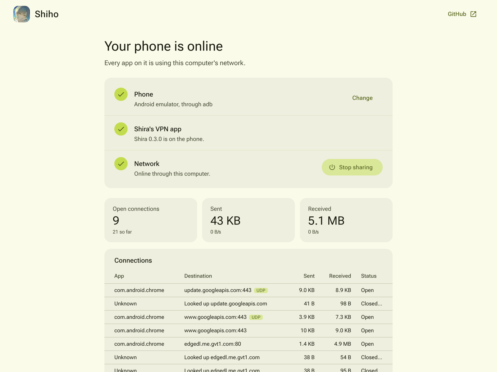

<p align="center">
  
</p>

<h1 align="center">Shiho</h1>

<p align="center">Your phone online through your computer, from an Isolated Web App: Direct Sockets, one USB cable and Shira's VPN</p>

<p align="center">
  <a href="https://github.com/wonderhoy-labs/shiho/actions/workflows/ci.yml"></a>
  <a href="LICENSE"></a>
  <a href="#license-and-credits"></a>
  <a href="https://wonderhoy-labs.github.io/shiho/"></a>
</p>

Shiho gives an Android phone your computer's network over a USB cable. Every app on the phone gets online through it,
and so do [Minori](https://github.com/wonderhoy-labs/minori)'s Linux machines and Android's own Terminal, even with the
phone's Wi-Fi and mobile data turned off.

It runs in Chrome as an [Isolated Web App](https://chromeos.dev/en/web/isolated-web-apps). On the phone,
[Shira](https://github.com/wonderhoy-labs/shira)'s VPN app hands every connection over USB debugging to Shiho, and
Shiho opens that same connection from the computer with Chrome's
[Direct Sockets](https://developer.chrome.com/docs/iwa/direct-sockets). Shira's own page relays the connections through
a Wisp server; Shiho needs none, and nothing else runs on the computer. It's for anyone who wants the cable-tethered
network of [Akiyama](https://github.com/wonderhoy-labs/akiyama) or [Saki](https://github.com/wonderhoy-labs/saki)
without installing a native program.

<p align="center">
  
</p>

Shiho is early software. [What has been tested](#what-has-been-tested) says exactly what ran.

## What you need

- Chrome 156 or newer on macOS, Linux, Windows or ChromeOS, with Isolated Web App developer mode (see below). Only the
  Mac has been tried.
- An Android phone with USB debugging on, and a USB cable that carries data. Shiho installs Shira's app on it. Shira's
  app needs Android 10 or newer.
- For Minori's machines and Android's Terminal, Minori 0.3.0 or newer on the phone, with its Terminal switch on.

## Install

Isolated Web Apps come as signed web bundles. Outside managed ChromeOS, Chrome only installs one in its developer mode
for them.

1. In Chrome, open `chrome://flags/#enable-isolated-web-app-dev-mode`, set it to Enabled and relaunch.
2. Download `shiho.swbn` from the [latest release](https://github.com/wonderhoy-labs/shiho/releases/latest) or the
   [site](https://wonderhoy-labs.github.io/shiho/).
3. Open `chrome://web-app-internals`, and under Isolated Web Apps choose "Install IWA from Signed Web Bundle". Pick the
   file.
4. Open Shiho from Chrome's apps or your computer's app list.

Every release is signed with the same key, so Shiho is always
`isolated-app://7bnazaslgp73mlrzgb7e2x3opemnthhgdnmwhjb3rfudf75pivtqaaic/`. Install a newer one the same way.

To build it yourself, see [Development](#development). A bundle you sign with your own key is a different app, with its
own address.

## Use it

### Put your phone online

1. Turn on USB debugging on the phone and plug it in.
2. Open Shiho. If the adb server is running on the computer, the phone shows up in the list by itself; pick it. Without
   adb, choose "Connect over USB" and pick it in Chrome's list. The phone asks once whether to allow the computer.
3. The first time, Chrome asks whether Shiho may "access other apps and services on this device". That's the adb
   server on your computer. Allow it.
4. Install Shira from the second step. Shiho carries the Shira version it needs.
5. Choose "Share this computer's network". The first time, the phone asks whether Shira may set up a VPN; tap OK.

Your phone stays online through the computer until you choose "Stop sharing", close Shiho, or unplug the phone. Then it
goes back to its own network.

### Minori's machines and Android's Terminal

There's nothing to set up in Shiho. Minori's machines get online through the phone's apps' network, so they follow
Shira's VPN like any app. Android's Terminal doesn't use VPNs on its own, but Minori 0.3.0 and newer carries its
traffic when its Terminal switch is on; see [Minori's README](https://github.com/wonderhoy-labs/minori).

### See what the phone is doing

Once it's online, Shiho shows how much went each way and every connection: which app made it, where it went, and how
it ended.

## Use it in your app

Shiho is a TypeScript library, `@wonderhoy-labs/shiho`, and its own app is built on it. It plugs into Shira's library
as the place the phone's connections go, so any page that uses Shira can open them itself instead of using a Wisp
server, once it's installed as an Isolated Web App.
[Asahi](https://github.com/wonderhoy-labs/asahi) uses it that way. Add a release by its address, next to Shira's:

```json
"@wonderhoy-labs/shiho": "https://github.com/wonderhoy-labs/shiho/releases/download/v0.1.0/wonderhoy-labs-shiho-0.1.0.tgz",
"@wonderhoy-labs/shira": "https://github.com/wonderhoy-labs/shira/releases/download/v0.3.0/wonderhoy-labs-shira-0.3.0.tgz"
```

```ts
import { adbServerClient, directSocketsUpstream, isDirectSocketsAvailable, trustSameOriginScripts } from "@wonderhoy-labs/shiho";
import { LogStore, Phone, ShiraLink } from "@wonderhoy-labs/shira";
import { Adb } from "@yume-chan/adb";

trustSameOriginScripts();
if (isDirectSocketsAvailable()) {
	const server = adbServerClient();
	const [device] = await server.getDevices(["device"]);
	const phone = new Phone(new Adb(await server.createTransport({ serial: device.serial })), device.serial, "adb-server");
	const link = new ShiraLink({ phone, upstream: directSocketsUpstream(), log: new LogStore(), events: {} });
	link.start("auto");
}
```

| Export | What it does |
| --- | --- |
| `directSocketsUpstream(options?)` | A Shira `UpstreamConnector` that opens the phone's TCP and UDP connections with Direct Sockets |
| `adbServerClient(options?)` | A Tango client for the adb server on this computer, over Direct Sockets: phones and emulators without WebUSB |
| `isDirectSocketsAvailable()` | Whether this page can open sockets itself, which only an Isolated Web App can |
| `trustSameOriginScripts()` | A Trusted Types default policy for the app's own scripts, which Shira's worker needs in an Isolated Web App |

The page has to be an Isolated Web App whose manifest allows `direct-sockets`, and `loopback-network`, `local-network`
and `local-network-access` for the adb server and anything on the local network; `web/plugins/shiho.ts` writes
Shiho's. The library leaves `@wonderhoy-labs/shira`, `@yume-chan/adb` and `@yume-chan/stream-extra` to you as peer
dependencies, and Shira's library needs wisp-js too, as its README says.

## What has been tested

All of this ran on 2026-11-11 on a Mac (Apple silicon, macOS 27), in Chrome for Testing 156.0.8078.4 with Isolated Web
App developer mode, from a signed bundle installed with `--install-isolated-web-app-from-file`. Chrome's Local Network
Access prompt was answered by presetting the profile's setting, because the test couldn't click it.

**On an Android 17 emulator** (`Minori_Test_API_37`), through the adb server: Shiho found it, updated Shira to 0.3.0, and
put it online with Wi-Fi and mobile data off. Chrome on the emulator loaded pages over TCP and QUIC, and
Shiho's log showed DNS, TCP and UDP with each app's name.

**On a Pixel 10 Pro running Android 17**, through the adb server, with Wi-Fi and mobile data off and Shira's VPN the
only network:

| What | Result |
| --- | --- |
| Shira 0.2.2 to 0.3.0 | Updated in place from Shiho |
| The phone's own apps | Online: Discord, Google apps, Play services |
| A Minori machine (Debian 13 with Xfce, on AVF) | `curl` fetched 10 MB from speed.cloudflare.com in 0.84 s, about 95 Mbit/s |
| Android's Terminal, through Minori 0.6.0's Terminal link | `curl` fetched the same 10 MB in 5.2 s, about 15 Mbit/s |

Both downloads show in Shiho's log as Minori's, because Minori's NAT opens them as app sockets.

**Not tried yet:** WebUSB (Chrome's device chooser needs a click the test couldn't give), Chrome's real Local Network
Access prompt, installing through `chrome://web-app-internals` by hand, Linux, Windows, ChromeOS, other phones, upload
speed, and long sessions.

## How it works

```
 phone apps, Minori's machines, the Terminal
          │
   Shira's VPN app (TUN, TCP/UDP ended in Kotlin)
          │  Shira's link: Wisp packets, over adb's localabstract:shira
          ▼
   USB debugging ── adb server on the computer, or WebUSB
          │
   Shiho in Chrome, an Isolated Web App
          │  one TCPSocket or UDPSocket per connection (Direct Sockets)
          ▼
   the computer's network
```

### On the phone

Shira's app is a VPN that ends every TCP connection and UDP flow on the phone and turns each into a stream on
[Shira's link](https://github.com/wonderhoy-labs/shira/blob/main/docs/protocol.md). DNS goes to a resolver inside the
app, which asks 1.1.1.1 over TCP. Shiho installs the app from the copy its build carries, so the two always match.

### On the computer

Shira's library runs the link: it greets the app, starts the VPN and keeps the log. Since Shira 0.3.0 the far end of
each stream is an "upstream", and Shiho's is Direct Sockets: a `TCPSocket` for each TCP stream and a connected
`UDPSocket` for each UDP flow. For TCP, Shiho tells the phone how many packets it can send ahead, the way a Wisp server
does, and gives credit back as the socket takes them, so a slow destination slows only its own app. Coming back,
Shiho stops reading sockets while the phone has a lot waiting, so the phone is never sent more than it can take.

### Finding the phone

Direct Sockets reach the adb server on `127.0.0.1:5037` too, so Shiho lists what `adb devices` lists, emulators
included, and leaves adb free for everything else. Chrome counts that as local network access, and asks once. Without
adb, WebUSB talks to the phone directly.

### Isolated Web App

The bundle is the built site, signed with an Ed25519 key. Its manifest grants Direct Sockets, Local Network Access and
WebUSB. Chrome runs it at `isolated-app://` with a strict content security policy and Trusted Types, so it loads only
what's in the bundle.

## Security and privacy

- **Everything the phone does goes through your computer**, and out of its network like the computer's own traffic.
  Shiho shows every connection, but doesn't save them.
- **USB debugging is powerful.** Shiho can do anything adb can on the phone it connects to. Only install the bundle
  from this repository's releases, and check its address is the one above.
- **Local network access.** Shiho asks Chrome for it to reach the adb server. With it, the phone can also reach your
  local network through Shiho, as it could through any tether.
- **On the cable,** Shira's app only takes connections from adb's shell user or root, so other apps on the phone can't
  see or inject traffic.
- Nothing leaves the computer except the phone's own traffic. Shiho has no server and no analytics.

## Troubleshooting

| Symptom | Fix |
| --- | --- |
| No phones in the list | Check `adb devices` lists it. Without adb, choose "Connect over USB". |
| "adb isn't running on this computer" | Run `adb start-server`, or connect over USB. |
| "Something else on this computer is using USB debugging" | The adb server has the phone. Pick it from the list instead. |
| The page is the site, not the app | Direct Sockets only exist in the installed app. Open Shiho from your apps. |
| "Waiting for the phone" doesn't end | Unlock the phone, and tap OK if it asks about a VPN connection. |
| Minori's Terminal isn't online | Turn on Minori's Terminal switch, and allow port 5741 in Terminal's settings. |

## Known issues

- Installing needs Chrome's Isolated Web App developer mode outside managed ChromeOS, and the page has no update
  manifest yet, so updates are installed by hand.
- The phone only gets IPv4, as with Shira.

## Development

| Path | What |
| --- | --- |
| `packages/shiho/` | The library, `@wonderhoy-labs/shiho`: Direct Sockets upstream, adb server client, Trusted Types |
| `web/` | The app and the site: React and mdui. It's the app when installed, and the install page anywhere else |
| `web/plugins/shiho.ts` | Versions and the Isolated Web App manifest |
| `tools/bundle.ts` | Signs `web/dist` into `web/dist/shiho.swbn` |

```bash
pnpm install
pnpm format && pnpm lint && pnpm typecheck && pnpm unify
pnpm --dir packages/shiho test
pnpm --filter ./web build
```

The web build carries Shira's APK from `@wonderhoy-labs/shira`, and ends by running `pnpm bundle`, which signs the
bundle with the key in `WEB_BUNDLE_KEY` or `~/.config/wonderhoy-labs/shiho/iwa-key.pem`, and skips it without one. CI
signs with the `SHIHO_IWA_KEY` secret. Never replace the key: it is Shiho's address.

To try a build, start Chrome with Isolated Web App developer mode and install the bundle:

```bash
"/Applications/Google Chrome.app/Contents/MacOS/Google Chrome" --enable-features=IsolatedWebApps,IsolatedWebAppDevMode --install-isolated-web-app-from-file="$PWD/web/dist/shiho.swbn"
```

To release, bump `VERSION` and `packages/shiho/package.json`, update the testing notes, then tag `v<VERSION>` and push.
CI publishes the library, the bundle and the site.

## License and credits

Shiho is a [Wonderhoy Labs](https://github.com/wonderhoy-labs) project, released under the
[Apache License 2.0](LICENSE). It isn't affiliated with Google. Android, Chrome and Pixel are trademarks of Google LLC.

It stands on the work of these projects:
- [Shira](https://github.com/wonderhoy-labs/shira) (Apache-2.0), for the VPN app and the link
- [Tango](https://github.com/yume-chan/ya-webadb) (MIT), for adb over WebUSB and the adb server
- [wbn and wbn-sign](https://github.com/WICG/webpackage) (W3C Software License), for signed web bundles
- [mdui](https://github.com/zdhxiong/mdui) (MIT), [React](https://react.dev) (MIT) and Roboto Flex (OFL-1.1), for the page

Shiho is named for Hinomori Shiho of Leo/need, from Project SEKAI COLORFUL STAGE! feat. Hatsune Miku. Wonderhoy Labs
is a fan project, not affiliated with SEGA, Colorful Palette or Crypton Future Media, who own Project SEKAI and
its characters. The Apache License doesn't cover the Shiho name or logo.
